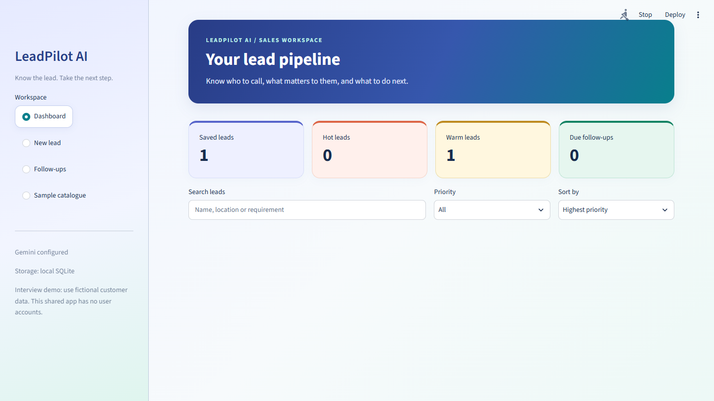
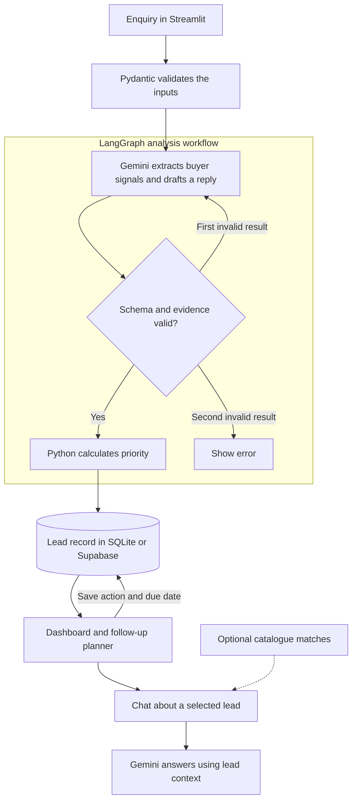

# LeadPilot AI

LeadPilot AI helps a real estate salesperson decide which buyer to contact next and what to ask. Enter an enquiry to get a priority score, the buyer’s stated requirements, open questions, and a suggested reply. The dashboard keeps the analysis alongside the next action and its due date.

**[Watch the product demo (2 min 57 sec)](https://youtu.be/ycotIAq30h0)**



[How it works](#how-it-works) · [Scoring](#how-lead-scoring-works) · [Quick start](#quick-start) · [Configuration](#configuration)

## How it works



1. **Capture the enquiry.** The [Streamlit form](app.py) takes a name, location, property requirement, budget in INR lakh, buying timeline, and customer message. It also offers [fictional sample enquiries](data/hybrid_leads.json).
2. **Extract and validate.** Gemini returns a structured analysis. [Pydantic](src/models.py) checks the fields and looks for a supporting quote in the enquiry for each known intent, timeline, and financing value. [LangGraph](src/workflow.py) retries invalid output once. An API error or a second invalid result ends the workflow before anything is saved.
3. **Score and follow up.** Python calculates the points below. The dashboard shows the breakdown under **Why this score?** A salesperson can review the suggested reply, choose a next action, set a date, and mark the follow-up complete.

## How lead scoring works

The [scoring function](src/scoring.py) adds four signals from the validated analysis. The score measures follow-up priority on a 100-point scale. Each row contributes once.

| Signal | Points awarded |
| --- | --- |
| Purchase intent | Buying **35** · Exploring **10** · Unknown **0** |
| Buying timeline | 0–30 days **30** · 31–90 days **20** · 91–180 days **10** · Later or unknown **0** |
| Financing | Ready **25** · Pending **10** · Unknown **0** |
| Stated requirements | One or more extracted requirements **10** · None **0** |

**Hot** is 70–100, **Warm** is 40–69, and **Cold** is 0–39. Budget affects which properties qualify for retrieval. It contributes no priority points.

In the video, Rahul scores **65/100 (Warm)**. Buying intent adds 35 points, his three-month timeline adds 20, and his stated requirements add 10. Financing adds 0 because he has yet to discuss it.

**Worked example.** In the bundled Dev Malhotra enquiry, the buyer wants a 2 BHK in Miyapur within 45 days and reports an approved loan plus savings. If Gemini extracts buying intent, a 45-day timeline, ready financing, and the 2 BHK requirement, the rule gives **35 + 20 + 25 + 10 = 90 (Hot)**. The arithmetic is repeatable for the same extracted facts. A salesperson can inspect the supporting quotes when a classification looks surprising.

## Chat and property matching

[Lead chat](src/chatbot.py) sends Gemini the selected buyer’s enquiry, saved analysis, follow-up, and the last ten messages from that lead’s conversation. Chat history belongs to the browser session. Leads and follow-ups are saved in the [database](src/database.py).

When catalogue search is enabled, [property retrieval](src/rag.py) filters the [sample listings](data/sample_properties.csv) by budget, location, and any explicit bedroom count. Sentence Transformers embeds the question and listing descriptions. FAISS ranks the eligible listings and returns up to three. If semantic search is unavailable, the app shows the eligible listings in price order.

## Quick start

From the repository root, create a Python 3.13 environment. On Windows PowerShell:

```powershell
python -m venv .venv
.\.venv\Scripts\python.exe -m pip install -r requirements.txt
if (!(Test-Path .env)) { Copy-Item .env.example .env }
```

On macOS or Linux:

```bash
python3.13 -m venv .venv
source .venv/bin/activate
python -m pip install -r requirements.txt
test -f .env || cp .env.example .env
```

Set `GEMINI_API_KEY` in `.env`, then start the app with `.\start.ps1` on Windows or `python -m streamlit run app.py` in the activated environment on macOS or Linux. Open [localhost:8501](http://localhost:8501). To try the scoring example, select Dev in **New lead**, choose **Fill hybrid enquiry**, then **Analyze and save lead**.

## Configuration

| Setting | When to use it |
| --- | --- |
| `GEMINI_API_KEY` | Required for AI analysis and chat. |
| `GEMINI_MODEL` | Override the Gemini model used by the app. |
| `DATABASE_PATH` | Change the default SQLite path, `data/leads.db`. |
| `SUPABASE_URL` and `SUPABASE_SERVICE_ROLE_KEY` | Run [schema.sql](schema.sql) in Supabase, then set both values to store leads and follow-ups there. |

**Streamlit Community Cloud.** Select this repository, branch `main`, entry point `app.py`, and Python 3.13. Enter credentials in the app’s **Secrets** settings. Use Supabase for records that must survive cloud restarts. The app has a shared dashboard without sign-in, so use fictional enquiries on public deployments.

**Development.** Install [requirements-dev.txt](requirements-dev.txt) in the project environment to include pytest, then run `python -m pytest -q`. The [test suite](tests/) covers scoring boundaries, analysis retries, property retrieval, persistence, chat context, and the Streamlit workflow.
