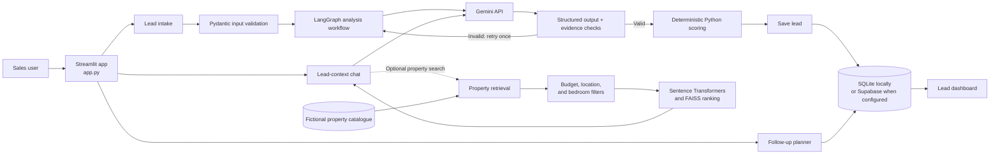

# LeadPilot AI

**AI-assisted lead qualification and follow-up for real estate teams.**

LeadPilot AI turns customer enquiries into structured lead insights, explainable priorities, relevant sample-property matches, and actionable follow-ups.

## At a glance

- **Understand each enquiry:** summarize intent, requirements, concerns, and missing details.
- **Prioritize transparently:** calculate a repeatable lead score with Python rules.
- **Respond with context:** draft customer replies and answer questions using the selected lead's information.
- **Keep work moving:** create and track dated follow-up actions.
- **Find relevant listings:** filter a fictional property catalogue, then rank eligible matches semantically.

## Architecture

The analysis path checks model output against typed schemas and evidence from the enquiry before computing a score. Scoring stays in application code, so the same validated analysis produces the same priority. Property search applies hard eligibility filters before semantic ranking; it does not use similarity to bypass budget, location, or bedroom constraints.

## Technology

| Area | Tools |
| --- | --- |
| User interface | Python, Streamlit |
| AI analysis and chat | Google Gemini API |
| Workflow | LangGraph |
| Data validation | Pydantic |
| Lead scoring | Deterministic Python rules |
| Local persistence | SQLite |
| Optional hosted persistence | Supabase REST API |
| Property retrieval | Sentence Transformers, NumPy, FAISS |

## Run locally

Use Python 3.13 with the pinned dependencies.

**Windows PowerShell**

    python -m venv .venv
    .venv\Scripts\Activate.ps1
    pip install -r requirements.txt
    Copy-Item .env.example .env
    streamlit run app.py

**macOS or Linux**

    python -m venv .venv
    source .venv/bin/activate
    pip install -r requirements.txt
    cp .env.example .env
    streamlit run app.py

Add your Gemini API key to .env before using AI analysis or chat:

    GEMINI_API_KEY=your_key_here
    GEMINI_MODEL=gemini-3.5-flash-lite

Then open http://localhost:8501. The first semantic property search may download the embedding model.

## Configuration

| Variable | Purpose |
| --- | --- |
| GEMINI_API_KEY | Enables Gemini analysis and chat |
| GEMINI_MODEL | Optional Gemini model selection |
| SUPABASE_URL | Optional Supabase project URL |
| SUPABASE_SERVICE_ROLE_KEY | Optional server-side Supabase credential |
| DATABASE_PATH | Optional SQLite file path; defaults to data/leads.db |

Configure both Supabase variables together to use hosted persistence. If they are unset, the app uses SQLite. Store credentials in environment variables or your hosting provider's secret manager; do not commit them.

## Deploy

To deploy with Streamlit Community Cloud:

1. Connect the GitHub repository udaykumar-3005/LeadPilotAI.
2. Choose the main branch and app.py entry point.
3. Add GEMINI_API_KEY and optional GEMINI_MODEL under app Secrets.
4. Configure both Supabase variables if lead data needs to persist across cloud restarts.

## Repository layout

    LeadPilotAI/
    |-- app.py                       Streamlit interface
    |-- assets/style.css             Application styling
    |-- data/
    |   |-- sample_properties.csv    Fictional property catalogue
    |   \-- hybrid_leads.json        Fictional sample enquiries
    |-- src/
    |   |-- ai.py                    Gemini API calls
    |   |-- chatbot.py               Lead-specific chat context
    |   |-- database.py              SQLite and Supabase persistence
    |   |-- models.py                Input/output schemas and evidence checks
    |   |-- prompts.py               Model prompts
    |   |-- rag.py                   Property filters and semantic ranking
    |   |-- scoring.py               Lead priority rules
    |   \-- workflow.py              LangGraph analysis workflow
    |-- tests/                       Automated tests
    |-- schema.sql                   Supabase schema and access policy
    \-- requirements.txt             Runtime dependencies

## Tests

    pip install -r requirements-dev.txt
    python -m pytest -q

## Notes

- The included enquiries and property catalogue are fictional examples.
- The app does not include user authentication. Do not use real customer data on a publicly accessible deployment without adding appropriate access controls.
- SQLite files on hosted instances may not be durable across restarts. Use Supabase when persistent hosted storage is required.
